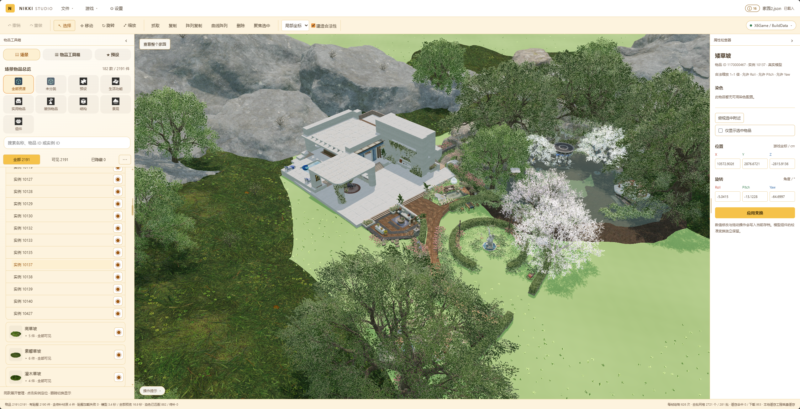
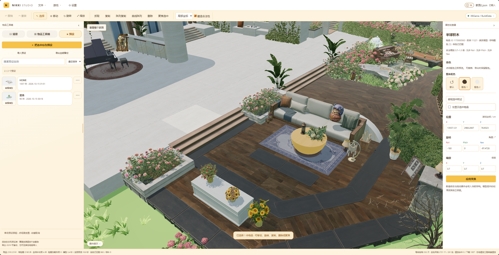
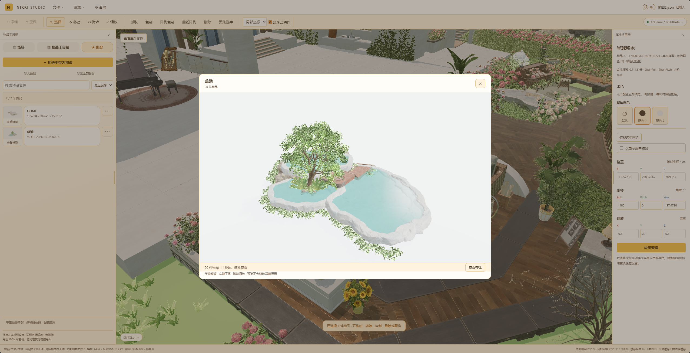

# Nikki Studio

面向《无限暖暖》的非官方本地家园存档编辑器，支持三维场景预览、家具编辑、染色与预设，以及 JSON 存档保存和导出。

当前处于开发与验证阶段，支持 Windows 源码运行，并提供 Windows x64 Portable 构建方式。普通用户使用免安装包的步骤见 [Portable 使用说明](docs/PORTABLE.md)；以下环境准备与安装命令供源码运行使用。

用户已反馈在云电脑准备环境后可以使用源码版；这不代替 Portable 成品在未安装开发工具的环境中的验收，也不代表所有游戏版本都兼容。

项目不附带游戏模型、贴图、AES 密钥、usmap 或玩家存档。这些输入需要用户自行准备，并与自己的游戏版本匹配。

受 https://github.com/ChanIok/BuildingMomo 启发，参考了部分代码。
## 🏡 界面预览

打开家园存档，在三维场景中查看布局，通过左侧列表选择家具，在右侧调整位置、旋转、缩放和可用配色。



截图来自当前网页端的实际家园场景。游戏资源由使用者的本机安装提供，画面与可用功能受游戏版本和解析支持范围影响。

<details>
<summary>查看更多：属性与染色、预设模型预览</summary>

**属性与染色**：选中场景中的物品，在右侧查看变换数值和可用配色。



**预设模型预览**：把组合保存在本机预设库中，放置前可在独立窗口旋转、缩放查看。



</details>

## 🧰 使用前准备

### 运行环境

| 工具 | 要求与用途 |
| --- | --- |
| Windows | 当前主要运行与验证平台，解析器构建目标为 Windows x64 |
| Python | 3.12 或更高版本，以下命令使用 Windows 的 `py` 启动器 |
| Node.js 与 npm | 使用 Node.js LTS，用于安装前端依赖 |
| Git | 下载项目及构建时获取固定版本的解析器源码 |
| .NET SDK | **10.0 或更高且支持 `net10.0` 的 SDK**，用于构建解析器；仅安装 .NET Runtime 或 .NET 8 SDK 不够 |
| 浏览器 | 建议使用 Chrome 或 Edge，以支持选择目录和写回存档 |

安装工具后，重新打开终端，确认以下命令都可执行：

```text
py -3 --version
node --version
npm --version
git --version
dotnet --list-sdks
```

GitHub Desktop 可以管理项目，但构建脚本还需要终端能直接执行 `git`。首次安装会下载 Python/npm 依赖、第三方解析器源码和 .NET 依赖，需要可用的网络。

### 游戏输入

- 已安装的《无限暖暖》游戏目录，包含 `X6Game`。
- 与游戏版本匹配的 AES JSON。
- 与游戏版本匹配的二进制 `.usmap` 文件。映射接口返回的 JSON 元数据不能代替该文件。
- 自己的家园 JSON 存档。

AES 与 usmap 的参考链接位于首次配置页面，程序不会自动抓取它们。

## 🚀 从源码启动

### 1. 下载源码

使用 GitHub Desktop 克隆本仓库，或在仓库页面通过 **Code → Download ZIP** 下载并解压。打开项目文件夹，在包含 `launch.py` 和 `README.md` 的目录打开终端。以下命令均在该目录执行。

### 2. 安装项目依赖

```text
py -3 -X utf8 scripts/setup_dependencies.py
```

脚本会创建工程内的 `.venv`，安装 Python 依赖，并通过 npm 锁文件安装前端依赖到 `node_modules`。等待命令成功结束后再继续。

### 3. 构建资源解析器

首次从源码使用、且没有自行准备兼容解析器时，需要执行：

```text
py -3 -X utf8 scripts/build_parser_worker.py
```

脚本会下载固定提交版本的 CUE4Parse 源码，并将包含运行时的解析器构建到 `local/parser-worker`。它不会打包整个编辑器，也不需要游戏密钥或存档。

成功后应存在 `local/parser-worker/Nikki.AssetWorker.exe`。构建失败时，先检查 Git、.NET SDK 和网络；进入 .NET 构建阶段后的诊断记录在 `test-results/WORKER_BUILD.log`。出现 `NETSDK1045` 时，检查是否实际使用了支持 .NET 10 的 SDK。

### 4. 启动编辑器

```text
.venv\Scripts\python.exe launch.py
```

程序会启动本地服务并打开浏览器，默认地址为 `http://127.0.0.1:8769`。如果没有自动打开，请手动访问该地址。使用期间保持终端运行，结束后可在终端按 `Ctrl+C` 停止服务。

以后启动只需执行这一步；依赖或解析器源码更新时，再按更新说明重新安装或构建。

## 🎨 首次配置与编辑

1. 在配置页面选择游戏目录，填写自己的 AES JSON，上传匹配的 `.usmap` 文件。默认会查找工程内已构建的解析器，也保留自备 CUE4Parse.CLI 的兼容入口。
2. 等待资源校验通过。解析器原生解压依赖首次初始化也可能需要网络。
3. 进入编辑器后，通过“文件 → 打开存档”载入 JSON；也可以通过“游戏 → 选择游戏目录”授权浏览器访问家园存档目录，再载入目标存档。
4. 编辑家具、布局或染色。首次使用模型时按需转换，后续复用本地缓存；不会预先导出整个家具库。
5. 使用“另存为存档”保存一个独立 JSON。浏览器支持时会打开保存对话框，否则通过下载保存文件。

“保存到游戏存档”需要先授权目标目录。写回前会备份原文件到 `NikkiStudioBackups`，并检查外部修改；如果游戏或其他程序已经更改该文件，需要重新载入后再编辑。建议首次验证先使用存档副本。

资源配置中的游戏路径供后端读取模型；“游戏 → 选择游戏目录”用于浏览器授权存档读写，两者需要分别配置。后续资源配置可在设置中查看。

## 📁 数据保存在哪里

| 内容 | 默认位置 |
| --- | --- |
| 用户配置、AES、usmap、预设 | `%LOCALAPPDATA%/NikkiStudio` |
| 生成的模型、贴图及预览缓存 | 工程内 `local/cache` |
| Python、前端及解析器依赖 | 工程内 `.venv`、`node_modules`、`local` |
| 导出存档 | 浏览器保存对话框选择的位置，或浏览器下载目录 |

运行不依赖 `dist`。配置和私有输入通过本地服务处理，不作为公开静态文件提供。

需要隔离配置和缓存时，可指定独立数据目录：

```text
.venv\Scripts\python.exe launch.py --data-dir local/isolated-data
```

显式 `--data-dir` 或环境变量 `NIKKI_STUDIO_DATA` 会将配置与缓存放入指定数据目录。普通启动仍使用默认用户目录；不要将密钥、映射或存档提交到仓库。

## ⚠️ 当前限制

- 三维预览依赖当前游戏资源、匹配的密钥和映射。未支持或缺失的资源可能显示占位，存档中的相应数据仍会保留。
- 部分动画、特效、地形、水体和材质效果存在近似，预览不保证与游戏画面完全一致。
- 建造限制校验尚未完整覆盖；编辑器能保存 JSON，不代表游戏一定接受修改后的存档。
- 游戏更新后可能需要新的 AES、usmap 或解析适配。程序会提示重新校验；旧缓存恢复视图只显示已经生成的旧模型。
- 现有真实场景验收只覆盖记录中的本机环境，不保证未来游戏版本或所有电脑均兼容。

详细说明见 [资源解析与兼容边界](docs/resource-compatibility.md)。

## 🧪 开发与测试

完成依赖安装后执行：

```text
.venv\Scripts\python.exe -X utf8 -m unittest discover -s tests -v
npm test
.venv\Scripts\python.exe -X utf8 scripts/audit_release.py
```

自动测试主要使用合成数据，不能代替真实游戏验收，也不能证明首次安装和真实解析器构建已经成功。

- [测试与验收说明](docs/TESTING.md)：自动测试、首次安装与真实游戏验收。
- [缓存管理](docs/cache-management.md)：缓存位置、清理和卸载。
- [架构说明](docs/ARCHITECTURE.md)：资源处理与存档设计。
- [更新记录](docs/CHANGELOG.md)。

## 📄 许可与第三方项目

本项目许可证见 [LICENSE](LICENSE)，第三方来源与许可见 [NOTICE.md](NOTICE.md)。本项目为非官方工具，与《无限暖暖》官方无隶属关系。
